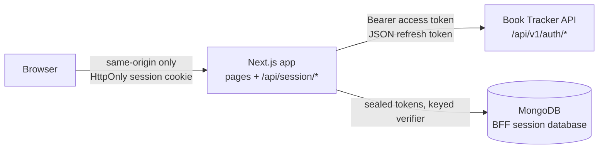
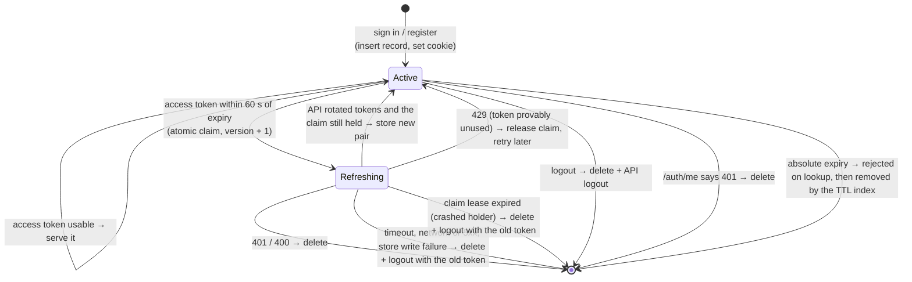
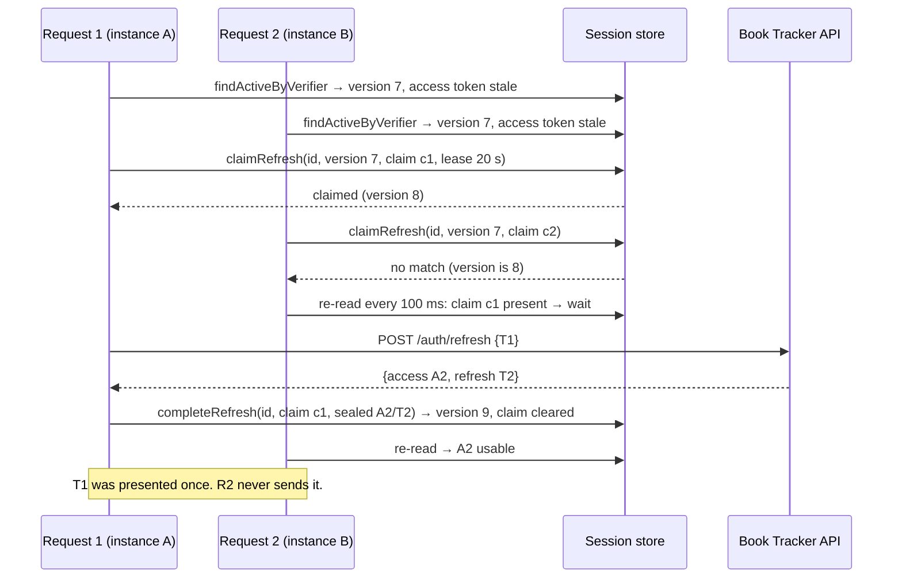

# Authentication and browser sessions

How Avuneri signs readers in without ever giving the browser an API token. Introduced in FE #16.
Code: `src/server/` (server-only), `src/app/api/session/*`, `src/proxy.ts`.

## 1. Shape of the system

- The browser talks only to this app. `connect-src 'self'` in the CSP and an e2e test that records
  every request enforce this.
- The app (the BFF) holds the API's access and refresh tokens in its session store, encrypted, and
  calls the API with `Authorization: Bearer` from server code only.
- The API is unchanged: JSON bearer tokens, `credentials: false` CORS, 15-minute access tokens,
  single-use refresh tokens with reuse detection, and a 30-day absolute session.

## 2. Threat model

| Threat                                   | Control                                                                                                                                                                                                                                                                                                                 |
| ---------------------------------------- | ----------------------------------------------------------------------------------------------------------------------------------------------------------------------------------------------------------------------------------------------------------------------------------------------------------------------- |
| XSS reads tokens                         | Tokens are never in the browser: not in JS, storage, readable cookies, HTML, RSC payloads or bundles (`check:bundle`, e2e token scan). The cookie is HttpOnly. A nonce-based CSP with `'strict-dynamic'`, no `unsafe-inline` and no `unsafe-eval` in production limits script injection.                                |
| XSS acts as the reader                   | HttpOnly cookies do not stop same-origin forged actions. The CSP is the control; there are no `dangerouslySetInnerHTML` sinks and no profile data inside scripts.                                                                                                                                                       |
| CSRF, including login CSRF               | Every state-changing session route requires `Origin` to equal `APP_ORIGIN` exactly. A missing or `null` Origin is refused. `Sec-Fetch-Site` must be `same-origin` when sent. Only `application/json` is accepted, with a body capped at 8 KiB. `SameSite=Lax` is extra. `Host` and `X-Forwarded-*` are never consulted. |
| Session fixation                         | Every sign-in issues a fresh 256-bit secret and ends any session the request already carried.                                                                                                                                                                                                                           |
| Stolen session database                  | It holds only an HMAC of each cookie, so cookies cannot be derived. Tokens are AES-256-GCM sealed with a key held outside the database. Ciphertexts are bound to their session and field.                                                                                                                               |
| Refresh-token replay / duplicate refresh | One atomic claim per session across all instances (section 4). The old token is never retried after an ambiguous failure.                                                                                                                                                                                               |
| Logout racing a refresh                  | The refresh result is stored only while its claim still exists. Logout deletes the session; the late result is revoked at the API, so nothing is resurrected.                                                                                                                                                           |
| Open redirect after sign-in              | `next` must exactly equal a known application path. Absolute, `//`, encoded, backslash and traversal forms can never match.                                                                                                                                                                                             |
| Cached private pages                     | Every page renders per request and is `no-store`. Session API responses are `no-store`. Logout does a full navigation, so the client router cache is discarded. Back navigation re-requests the page and redirects (e2e).                                                                                               |
| Credential or token leakage in logs      | Logs carry fixed event names, error class names, HTTP status and the API's request id only. They never include bodies, cookies, tokens, emails or upstream messages.                                                                                                                                                    |
| Misconfiguration                         | Missing or invalid configuration fails closed. There is no in-memory or cookie-only fallback. Production refuses loopback API or database URLs behind an https origin.                                                                                                                                                  |
| Brute force                              | The API's own limits apply (see the operational decision in section 9 about the shared BFF address).                                                                                                                                                                                                                    |

Out of scope: account takeover through the email address (the API has no email verification),
MFA, device management and "log out everywhere".

## 3. Session states

## 4. Replay-safe refresh

The API revokes the whole session if a refresh token is presented twice. So for each session,
exactly one request on any instance may exchange the current refresh token:

Properties, each tested against a real MongoDB (`session-service.integration.test.ts`):

1. **Single winner.** `claimRefresh` is one `findOneAndUpdate` that matches only the expected
   `version` with no existing claim. MongoDB's single-document atomicity decides the race; process
   memory is never involved. Test: 24 concurrent requests over two instances, each with its own
   MongoClient, produce exactly one API refresh and no reuse.
2. **Fenced write.** `completeRefresh` matches `refreshClaim.id`. If logout deleted the session,
   or the claim was abandoned, the write matches nothing. The new refresh token is then revoked at
   the API, and the session cannot come back. This is tested in both orders: the API slow before
   rotating and the API slow after rotating.
3. **No retry of an uncertain token.** A timeout, network error, 5xx, protocol error or store
   write failure after the call may mean the old token was consumed. The session is deleted, and
   the old token is presented once more only to `/auth/logout`. That revokes the backend session
   whether or not the token was consumed, because reuse detection covers logout too.
4. **Abandoned claims.** A claim older than its lease (20 s) means the holder crashed or stalled.
   The next request deletes the session (conditioned on that claim) and requires sign-in. It never
   refreshes. The lease exceeds the API call timeout (8 s) plus bounded store operations (3–4 s).
5. **429 is the only retryable failure.** The API rate-limits before reading the body, so a 429
   proves the token unused. The claim is released and the reader is asked to retry.
6. **Absolute expiry is preserved.** Lifetimes count from when the request was sent. The stored
   session end is `min(current, sentAt + refreshExpiresIn)`, so refreshing never extends it. Every
   lookup filters `sessionExpiresAt > now` because TTL deletion is eventually consistent.

**Clock assumption:** leases and expiry use each app instance's clock. Instances must be
NTP-synchronised. A few seconds of skew only shortens the effective lease, which still exceeds a
refresh's worst case.

**Access token versus session lifetime:** the access token (about 15 min) is refreshed
transparently. The cookie and the record expire with the API's absolute session (30 days). They
are never derived from the access token.

## 5. Cookie matrix

| `APP_ORIGIN`                               | Cookie name              | `Secure` | `HttpOnly` | `SameSite` | `Path` | `Domain` | `Expires`                      |
| ------------------------------------------ | ------------------------ | -------- | ---------- | ---------- | ------ | -------- | ------------------------------ |
| `https://…` (any deployment)               | `__Host-avuneri_session` | yes      | yes        | Lax        | `/`    | none     | the API session's absolute end |
| `http://localhost` / `127.0.0.1` / `[::1]` | `avuneri_session_local`  | no       | yes        | Lax        | `/`    | none     | the same                       |

- The value is 256 random bits (base64url). The store keeps only `HMAC-SHA256(verifierKey, value)`.
- The mode follows trusted static configuration (`APP_ORIGIN`), never request headers. Plain
  `http://` is accepted only for loopback, so a reachable deployment always gets the `__Host-`
  cookie. Each mode ignores the other's cookie name.
- Logout and session-ended responses delete the cookie with the same name, path and flags.
- `SameSite=Lax` (not Strict) lets a reader follow a link from email into a signed-in page. CSRF is
  handled by the Origin check, not by SameSite.

## 6. Keys and secrets

| Variable                     | Contents                           | Rules                                                                                                        |
| ---------------------------- | ---------------------------------- | ------------------------------------------------------------------------------------------------------------ |
| `BFF_SESSION_ENCRYPTION_KEY` | 32 random bytes, base64url         | Exactly 32 bytes, at least 16 distinct. HKDF derives independent token-encryption and verifier keys from it. |
| `BFF_SESSION_MONGODB_URI`    | URI with a dedicated database name | Not `admin`, `local`, `config` or `test`. Not loopback behind an https `APP_ORIGIN`.                         |
| `APP_ORIGIN`                 | Exact public origin                | https, or loopback http for local use.                                                                       |
| `API_BASE_URL`               | API base including `/api/v1`       | https. Not loopback behind an https `APP_ORIGIN`.                                                            |

Validation errors name the variable and rule, never the value.

**Rotating the encryption key** (for example after a suspected leak): deploy the new key to every
instance at once. Existing sessions can no longer be opened; each is treated as corrupted, deleted,
and its reader signs in again. To also end the API sessions, revoke them at the API (an API
operator task), because the old tokens can no longer be decrypted to log out. There is no dual-key
grace period yet; add a key id to the `v1.` sealed format if one is needed.

**Generating a key** without printing it:
`node -e "process.stdout.write(require('node:crypto').randomBytes(32).toString('base64url'))"`,
piped straight into the secret store.

## 7. Failure modes

| Failure                               | Reader sees                                                                     | Session                                        |
| ------------------------------------- | ------------------------------------------------------------------------------- | ---------------------------------------------- |
| API unreachable during sign-in        | "Avuneri can't be reached right now" (never "wrong password")                   | None created                                   |
| API 429 during sign-in                | "Too many attempts. Wait about N minutes" (from `Retry-After`)                  | None created                                   |
| Session store down during sign-in     | Service unavailable                                                             | The just-issued API session is logged out      |
| Store down while browsing             | Error page ("Avuneri is unavailable"); no private content                       | Unchanged                                      |
| API down while a refresh is due       | Signed out at the next request (conservative: the token may have been consumed) | Deleted; API logout attempted                  |
| API down on a page with a fresh token | Error page                                                                      | Unchanged                                      |
| Instance crashes mid-refresh          | Signed out at the next request after the 20 s lease                             | Deleted; API logout with the old token         |
| Store unreachable at logout           | "Signed out on this device; the server session will expire on its own"          | Cookie removed; record expires by TTL          |
| API unreachable at logout             | Same honest notice                                                              | Record deleted; API session ends at its expiry |
| Indexes missing in production         | Sign-in and private pages fail closed until the operator applies them           | n/a                                            |
| Invalid configuration                 | 503 on the session API, error page on pages                                     | n/a                                            |

## 8. Local development

1. Start a disposable MongoDB 8:
   `docker run -d --rm --name avuneri-bff-mongo -p 127.0.0.1:27018:27017 mongo:8.0`.
2. Run the API locally (`book-tracker-backend`, port 3000).
3. `cp .env.example .env.local` and generate `BFF_SESSION_ENCRYPTION_KEY` as described there.
4. `npm run dev` (port 3100). In development, missing session indexes are created automatically.

Tests: `npm run test:integration` uses `BFF_SESSION_TEST_MONGODB_URI` (default
`mongodb://127.0.0.1:27018`, loopback only). Each test creates and drops its own
`avuneri-bff-test-xxxxxxxx` database and refuses any other name. `npm run test:e2e` runs the
production build against a local fake of the API's auth endpoints and the `avuneri-bff-e2e`
database.

## 9. Production prerequisites and open operational decisions

None of these is provisioned or approved by this change.

1. **Hosting for this app.** It needs a Node.js runtime: route handlers, the proxy and
   server-rendered pages. Static hosting will not work. Any number of instances may run, because
   all session state is in MongoDB.
2. **Session database.** A dedicated database (for example `avuneri-bff`) and its own database
   user, with `readWrite` on that database only. Do not reuse the API's credentials. Indexes are
   created by the operator before traffic (`npm run session-store:indexes -- --apply` with an
   index-capable user), then verified read-only (`npm run session-store:indexes`). On Atlas M0
   (one free cluster per project) the session database could share the API's cluster under a
   separate user. That choice, and any cost, is the owner's.
3. **API rate limits now see one client.** The API limits authentication per client address. With
   `TRUST_PROXY_HOPS=0` (BE #14's default), and in any case behind this BFF, every reader shares
   the BFF's address. That means 100 auth requests (sign-ins, registrations, refreshes and logouts)
   per 15 minutes, 20 registrations per hour and 30 failed logins per 15 minutes, **for everyone
   combined**. Each active reader refreshes about every 14 minutes. This is fine for a private,
   small-audience launch, but limits growth. Options: (a) accept for V1; (b) an API change to trust
   a client address forwarded by the BFF over an authenticated channel; (c) add per-client limits
   in the BFF or at the edge. The per-account failed-login limit is unaffected. **Owner decision
   needed before launch.**
4. **`APP_ORIGIN`** must be the exact https origin readers use. Behind a proxy or CDN the app never
   derives it from headers.
5. **HSTS** is sent when `APP_ORIGIN` is https. Preloading is a separate decision.
6. **Clock synchronisation** (NTP) on every instance.
7. **Encryption key** generated into the host's secret store (section 6).
8. **CSP.** Enforced, with no unsafe allowances in production. Development adds only `'unsafe-eval'`,
   for React's debugging. Any future third-party script or style origin needs a deliberate CSP change.
