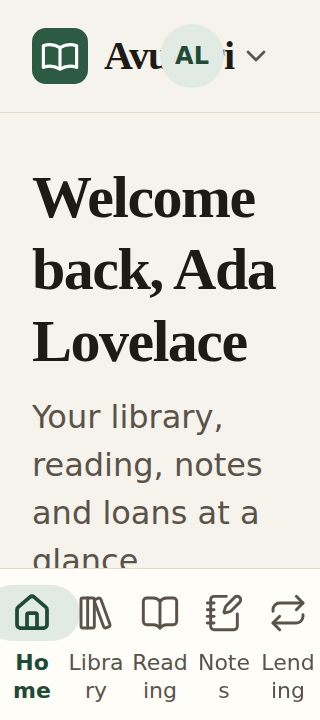
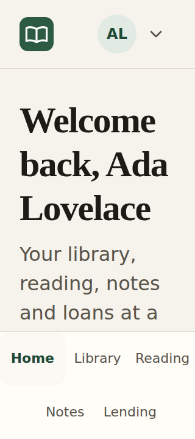
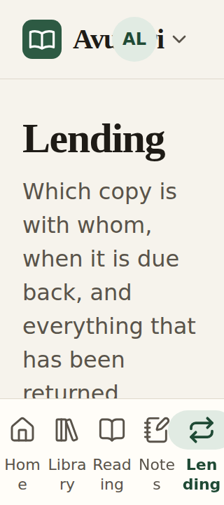
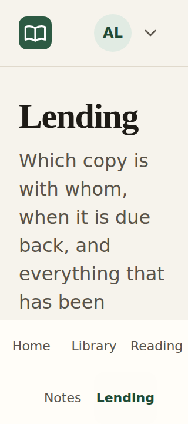

# Release evidence (FE #20)

**Date:** 2026-11-17. **Base:** `main` at `c7983fd` (FE #19 merged; CI
[run 43967328840](https://github.com/chineduknight/book-tracker-frontend/actions/runs/43967328840)
green). **Branch:** `feat/final-qa-launch-readiness`, PR
[#6](https://github.com/chineduknight/book-tracker-frontend/pull/6). **API pinned for tests:**
`book-tracker-backend` at `fea9c12` (unchanged; backend `main` is `9e2d9ef`).

The evidence run is CI run [44096689826](https://github.com/chineduknight/book-tracker-frontend/actions/runs/44096689826) at **`6ddf2fb`** (all three jobs green). The only later
changes are a test fix for the one flaky test below and this document; the PR description gives the
final head SHA and its CI run.

Statuses: **pass**, **fail**, **not run** (with what is needed), **n/a**. Nothing below is marked
pass without the source named.

## Automated checks

| Check                                                                              | Result                                                                                                                                                                           | Source                                                                                                                                                                              |
| ---------------------------------------------------------------------------------- | -------------------------------------------------------------------------------------------------------------------------------------------------------------------------------- | ----------------------------------------------------------------------------------------------------------------------------------------------------------------------------------- |
| Typecheck, lint (0 warnings), Prettier                                             | pass                                                                                                                                                                             | CI [44096689826](https://github.com/chineduknight/book-tracker-frontend/actions/runs/44096689826)                                                                                   |
| Unit and component tests                                                           | pass: 551 passed, 0 failed                                                                                                                                                       | CI [44096689826](https://github.com/chineduknight/book-tracker-frontend/actions/runs/44096689826); local run 2026-11-17                                                             |
| Session store integration (MongoDB 8: refresh races, leases, expiry, index safety) | pass: 37 passed                                                                                                                                                                  | CI [44096689826](https://github.com/chineduknight/book-tracker-frontend/actions/runs/44096689826); local                                                                            |
| Contract tests against the pinned real API (`fea9c12`)                             | pass: 26 passed                                                                                                                                                                  | CI [44096689826](https://github.com/chineduknight/book-tracker-frontend/actions/runs/44096689826); local                                                                            |
| Design-token contrast                                                              | pass                                                                                                                                                                             | CI [44096689826](https://github.com/chineduknight/book-tracker-frontend/actions/runs/44096689826)                                                                                   |
| Production build; bundle scanned for server-only values                            | pass                                                                                                                                                                             | CI [44096689826](https://github.com/chineduknight/book-tracker-frontend/actions/runs/44096689826)                                                                                   |
| Playwright, Chromium (mobile + desktop, real API + fake auth API)                  | pass: 310 passed, 46 skipped, 0 failed                                                                                                                                           | CI [44096689826](https://github.com/chineduknight/book-tracker-frontend/actions/runs/44096689826); local 2026-11-17: 308 passed, 42 skipped, 0 failed (before the last two commits) |
| Playwright, Firefox 159.0 and WebKit 27.2 (`@critical`)                            | pass: 65 passed, 20 skipped, 0 failed; 1 flaky (WebKit library journey: the test navigated before a save finished; it passed on retry, and the wait is fixed in the next commit) | CI [44096689826](https://github.com/chineduknight/book-tracker-frontend/actions/runs/44096689826), job "Critical path in Firefox and WebKit"                                        |
| `npm audit --omit=dev`                                                             | pass: 0 vulnerabilities                                                                                                                                                          | CI [44096689826](https://github.com/chineduknight/book-tracker-frontend/actions/runs/44096689826); local                                                                            |
| `npm audit` including dev dependencies                                             | **7 moderate, dev-only** (one advisory, GHSA-g3hv-75wg-m249, `minimatch` via `typescript-eslint`); 0 high, 0 critical                                                            | local 2026-11-17; decision D3 in launch-readiness.md                                                                                                                                |
| gitleaks, full history                                                             | pass                                                                                                                                                                             | CI [44096689826](https://github.com/chineduknight/book-tracker-frontend/actions/runs/44096689826)                                                                                   |

Skipped Playwright tests are by design: phone-only tests skip in desktop projects and the reverse,
and desktop-only tests that register a fresh reader run once.

## Before and after: 320px, 200% text

Captured by the CI visual walkthrough on Linux Chromium: "before" from `main` at `c7983fd`
(run 43967328840), "after" from this branch (run 44078959194). Synthetic accounts only.

| Before (FE #19)                                                                                                        | After (FE #20)                                                                                          |
| ---------------------------------------------------------------------------------------------------------------------- | ------------------------------------------------------------------------------------------------------- |
|  |  |
|                                                          |                                             |

Also: [account menu at 320px and 200% text](evidence/fe20/after-320-200pct-account-menu.png) and
[a rejected overdue reference day](evidence/fe20/after-390-overdue-rejected-day.png). The full set
(dialogs, the long note editor, landscape, 768px at 200% text, dark mode) is in each CI run's
`visual-walkthrough` artifact.

## Go / no-go criteria

| #   | Criterion (FE #20 brief §9)                                                             | Status                                                                                                                          | Evidence                                                                                                            |
| --- | --------------------------------------------------------------------------------------- | ------------------------------------------------------------------------------------------------------------------------------- | ------------------------------------------------------------------------------------------------------------------- |
| 1   | FE #19 merged; based on current `main`                                                  | pass                                                                                                                            | base `c7983fd`, run 43967328840                                                                                     |
| 2   | No new functional scope; no backend change                                              | pass                                                                                                                            | diff: shell, lending reference day, Home wording, unsaved-changes guard, tests, docs. No backend repository change. |
| 3   | Header and five-tab bar usable at 320px/200% text: no clipping, overlap or split labels | pass                                                                                                                            | `shell-reflow.spec.ts` (Chromium, WebKit iPhone); before/after captures in the PR                                   |
| 4   | No 320px/200% overflow on critical pages; 400% reflow inspected                         | pass (automated); **400% on a real browser: not run**                                                                           | `shell-reflow.spec.ts`, `reading-notes-layout.spec.ts`; qa-matrix.md                                                |
| 5   | A malformed overdue day never silently becomes today                                    | pass                                                                                                                            | `lending.test.ts`, `lending.spec.ts`                                                                                |
| 6   | "Books ever finished" tile and its destination agree                                    | pass                                                                                                                            | `home-sections.test.tsx`, `home.spec.ts` (a book finished twice: +1 on the tile, two rows on the page)              |
| 7   | Back/Forward unsaved-changes gap fixed or assessed                                      | **fixed in Chromium and Firefox; not guarded in Safari/iOS (WebKit trapped Back after a cancel), owner acceptance needed (D1)** | `history-guard.spec.ts`; launch-readiness.md §3                                                                     |
| 8   | Firefox/WebKit checks; manual Safari and screen-reader plan with honest statuses        | automated: pass (65 passed, 1 flaky, fixed); **manual: not run**                                                                | qa-matrix.md                                                                                                        |
| 9   | Full CI green at the final SHA                                                          | pass at `6ddf2fb`; final head in the PR description                                                                             | PR description                                                                                                      |
| 10  | No secret, token or cross-reader regression; API contract unchanged                     | pass                                                                                                                            | `security.spec.ts`, `library-security.spec.ts`, lending/notes privacy tests, bundle check, gitleaks                 |
| 11  | BE #14 and production prerequisites tracked                                             | pass                                                                                                                            | launch-readiness.md §3, §7                                                                                          |
| 12  | PR with SHA, CI links, counts, visuals and go/no-go summary                             | pass                                                                                                                            | PR #6                                                                                                               |
| 13  | No merge, deployment, paid provisioning, DNS, index change or production data           | pass                                                                                                                            | nothing was created outside this repository and its CI                                                              |

## Security and privacy review (this milestone)

| Control                                                                                                                                                              | Status                                             | Evidence                                                                                                                                                       |
| -------------------------------------------------------------------------------------------------------------------------------------------------------------------- | -------------------------------------------------- | -------------------------------------------------------------------------------------------------------------------------------------------------------------- |
| Tokens and the encryption key never in HTML, RSC payloads, bundles, URLs, error bodies or browser network calls                                                      | pass                                               | `security.spec.ts` ("backend tokens never reach the browser", "the browser talks only to this app"), `check:bundle`, leak regex in lending/notes/library specs |
| Exact-Origin check on every POST/PATCH/PUT/DELETE, sign-in and logout included; JSON content type; byte limits (session 8 KiB, library/lending 32 KiB, notes 100 kB) | pass                                               | route and session handler tests; `library-security.spec.ts`                                                                                                    |
| Unknown fields and query parameters, repeated parameters, malformed ids refused before any API call; foreign records indistinguishable from missing                  | pass                                               | `library-route.test.ts`, `reading-notes-route.test.ts`, `lending-route.test.ts`, contract tests                                                                |
| CSP nonce with `strict-dynamic`, no unsafe-eval/inline in production; `no-store`; `noindex` header and meta                                                          | pass                                               | `security.spec.ts`; `X-Robots-Tag` added in this milestone                                                                                                     |
| HSTS and the `__Host-` cookie over real TLS                                                                                                                          | **not run** (needs an HTTPS host: Gate B)          | unit tests cover the attributes only                                                                                                                           |
| Reader text (notes, borrower names) inert                                                                                                                            | pass                                               | "reader text is shown as text, never run"; rejected reference day rendered as text                                                                             |
| Borrower names and contacts never in URLs, metadata, logs or the activity feed                                                                                       | pass                                               | `lending.spec.ts` privacy test; contract test checks the feed                                                                                                  |
| Logs: allowlisted fields only; configuration errors never echo values                                                                                                | pass (inspection + `config.test.ts`)               | `src/server/log.ts`                                                                                                                                            |
| Session store: one refresh across instances, leases, uncertain refresh ends the session, absolute 30 days, no revival, fail closed                                   | pass                                               | session integration tests (MongoDB 8)                                                                                                                          |
| Remote session store requires verified TLS; separate least-privilege user                                                                                            | code: pass; **user and network: not run** (Gate B) | `config.test.ts`, `session-store-client.test.ts`                                                                                                               |

## Outstanding items

| Priority | Item                                                                                       | Owner action                                                            |
| -------- | ------------------------------------------------------------------------------------------ | ----------------------------------------------------------------------- |
| P1       | D1: in Safari and on iOS, Back discards unsaved changes without asking                     | Accept for V1, or ask for a mitigation, after the manual Safari check   |
| P1       | D2: API authentication limits shared by all readers behind the BFF                         | Accept for a small V1 or approve an API/edge change; measure on staging |
| P1       | Every Gate B check (real HTTPS, cookies, indexes, BE #14 staging gates, latency, rollback) | Approve staging scope and budget                                        |
| P2       | Manual Safari + VoiceOver, keyboard-only, TalkBack, 400% zoom, on-screen keyboard          | Run on devices; record in qa-matrix.md                                  |
| P2       | Repin the contract tests to the backend commit chosen for staging                          | Before staging                                                          |
| P2       | D3: dev-only `minimatch` advisory                                                          | Update `typescript-eslint` after 2026-11-30                             |
